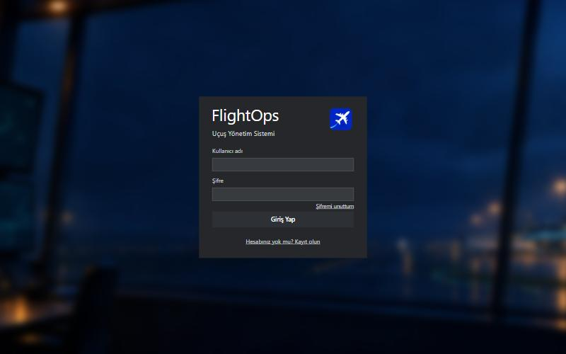
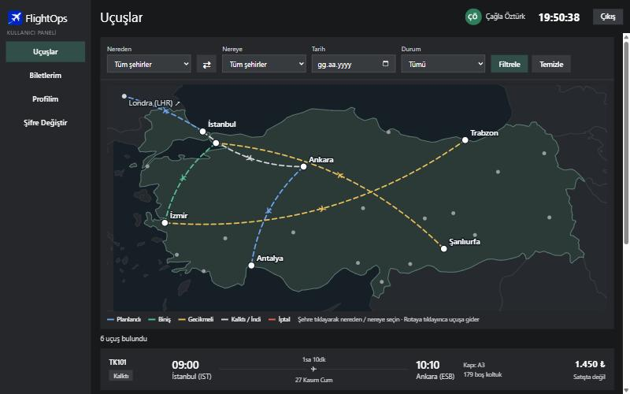
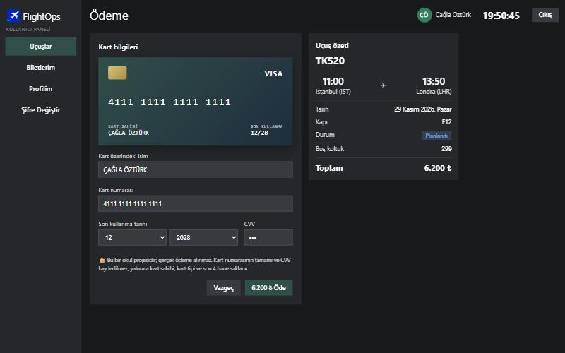
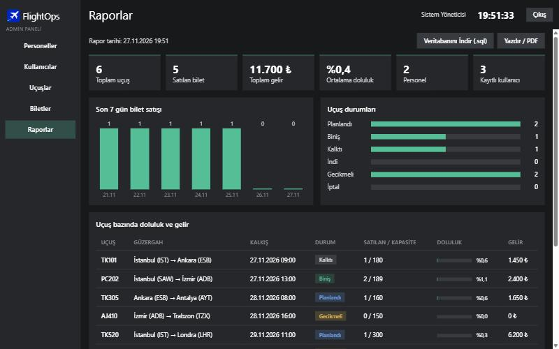
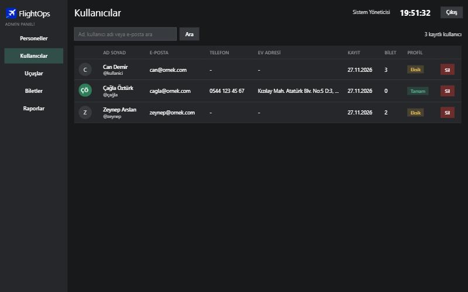
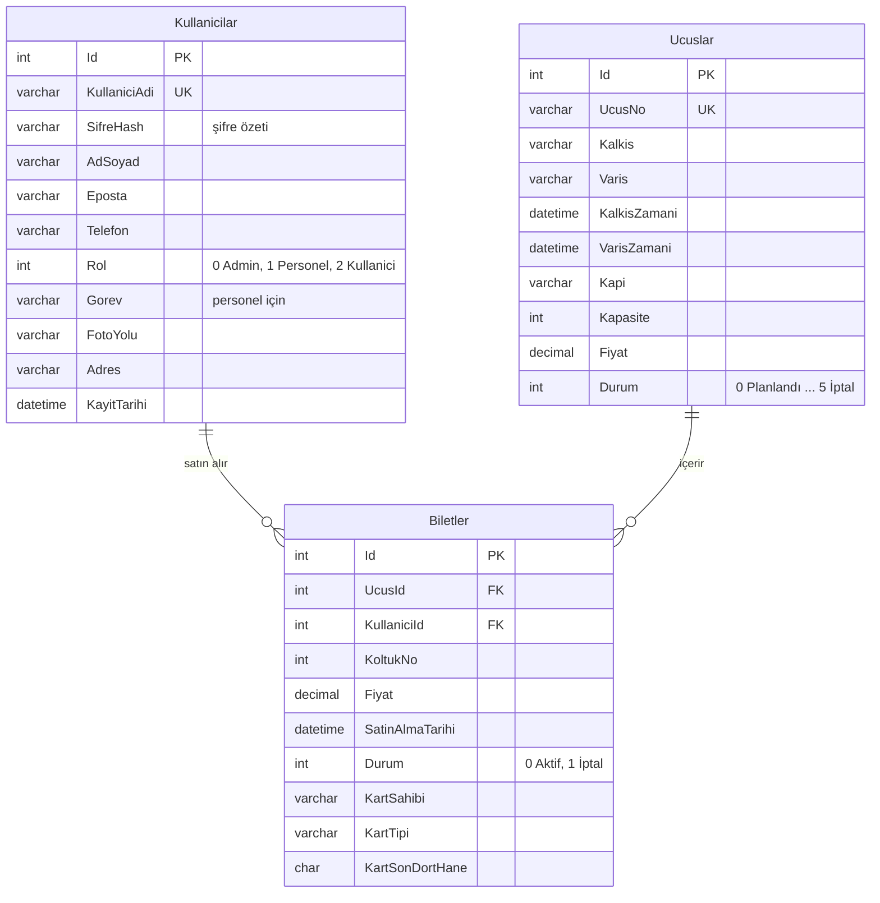

# ✈️ FlightOps – Uçuş Yönetim Sistemi

Havalimanı uçuş operasyonlarını yönetmek için geliştirilmiş, **C# / ASP.NET Core MVC** ile yazılmış bir web uygulaması.
Admin, personel ve kullanıcı olmak üzere üç rol tek bir giriş ekranını kullanır; her rol kendi paneline yönlendirilir.
Veriler **MySQL** veya kurulum gerektirmeyen **SQLite** veritabanında tutulur.

> İstanbul Gelişim Üniversitesi · Meslek Yüksek Okulu · Bilgisayar Programcılığı Programı\
> **Görsel Programlama – Final Projesi**\
> Ödev Danışmanı: **Öğr. Gör. Naciye Macit Sezikli**



## Proje ekibi

| Ad Soyad | GitHub |
|---|---|
| Eyüp Eren Özgiden | [erenozgiden](https://github.com/erenozgiden) |
| Kaan Berat Bayraktar | [kaanbayraktar1](https://github.com/kaanbayraktar1) |
| Ahmetcan Çelik | [Ahmetcan55](https://github.com/Ahmetcan55) |
| Hüzeyfe Alravi | [huzeyfealravi-code](https://github.com/huzeyfealravi-code) |
| Mehmet Ali Doğan | [doanaliali](https://github.com/doanaliali) |

---

## İçindekiler

- [Özellikler](#özellikler)
- [Ekran görüntüleri](#ekran-görüntüleri)
- [Kullanılan teknolojiler](#kullanılan-teknolojiler)
- [Kurulum ve çalıştırma](#kurulum-ve-çalıştırma)
- [Test hesapları](#test-hesapları)
- [Veritabanı](#veritabanı)
- [Proje yapısı (MVC)](#proje-yapısı-mvc)
- [Güvenlik](#güvenlik)

---

## Özellikler

### 🔐 Ortak giriş
- Tek giriş ekranı; kullanıcının rolüne göre **Admin**, **Personel** veya **Kullanıcı** paneli açılır.
- Rol bazlı yetki: bir rol başka rolün sayfasını açamaz ("Erişim Engellendi").
- **Kayıt ol** (profil fotoğrafı ve ev adresi zorunlu) ve **Şifremi unuttum** (kullanıcı adı + kayıtlı e-posta ile).

### 👤 Admin paneli
- **Personeller:** fotoğraflı personel ekleme, silme, güncelleme.
- **Kullanıcılar:** kayıtlı kullanıcıları listeleme, arama, silme.
- **Biletler:** tüm satılan biletleri görme, filtreleme, iptal etme.
- **Raporlar:** toplam uçuş, satılan bilet, gelir, doluluk oranı, son 7 günün satış grafiği, uçuş durumları, en çok bilet alan yolcular; yazdırma / PDF.
- **Veritabanını İndir (.sql):** güncel veritabanını MySQL'e aktarılabilen tek bir `.sql` dosyası olarak indirme.

### 🧑‍✈️ Personel paneli
- Uçuş **ekleme, silme, güncelleme**; listeden tek tıkla durum değiştirme (Planlandı, Biniş, Kalktı, İndi, Gecikmeli, İptal).
- Hatalı girişleri engelleyen doğrulamalar (varış saati kalkıştan önce olamaz, aynı uçuş numarası iki kez eklenemez, kapasite satılan biletten az olamaz).

### 🧳 Kullanıcı paneli
- **Türkiye uçuş haritası:** uçuşlar şehirden şehre, durumlarına göre renkli rotalarla gösterilir; yurt dışı uçuşlar harita kenarında işaretlenir.
- **Nereden / Nereye filtresi:** listeden ya da haritada şehre tıklayarak seçim; tarih ve duruma göre filtreleme.
- **Kredi kartıyla bilet alma:** canlı kart önizlemesi, kart tipi tanıma (Visa, Mastercard, Troy, Amex), kart numarası doğrulaması (Luhn).
- **Biletlerim:** alınan biletler ve iptal.
- **Profilim** (fotoğraf, ev adresi, iletişim) ve **Şifre değiştir**.

---

## Ekran görüntüleri

| Kullanıcı – Türkiye uçuş haritası | Kullanıcı – Kredi kartıyla ödeme |
|---|---|
|  |  |

| Admin – Raporlar | Admin – Kullanıcılar |
|---|---|
|  |  |

---

## Kullanılan teknolojiler

| Alan | Teknoloji |
|---|---|
| Dil | C# 12 |
| Çatı | ASP.NET Core 8 MVC (Model – View – Controller) |
| Veritabanı erişimi | Entity Framework Core 8 |
| Veritabanı | MySQL 8 (Pomelo.EntityFrameworkCore.MySql) veya SQLite |
| Arayüz | Razor (cshtml), HTML, CSS, JavaScript, SVG harita |
| Kimlik doğrulama | Çerez tabanlı oturum, rol bazlı yetkilendirme |

---

## Kurulum ve çalıştırma

### Gereksinimler
- [.NET 8 SDK](https://dotnet.microsoft.com/download) veya daha yeni bir sürüm
- (İsteğe bağlı) [Visual Studio Code](https://code.visualstudio.com/) ve **C# Dev Kit** eklentisi
- (İsteğe bağlı) MySQL 8.0.16 veya üzeri – yalnızca MySQL ile çalıştırmak için

### Çalıştırma

```bash
git clone https://github.com/erenozgiden/FlightOps_Paylasim.git
cd FlightOps_Paylasim
dotnet run
```

Uygulama açılınca tarayıcı kendiliğinden **http://localhost:5080** adresini açar.

**VS Code ile:** klasörü açın (`Dosya → Klasör Aç`) ve **F5**'e basın.

> Varsayılan veritabanı SQLite'tır; hiçbir kurulum gerekmez. İlk açılışta veritabanı oluşturulur ve örnek verilerle doldurulur.

---

## Test hesapları

| Kullanıcı adı | Şifre | Rol | Açılan panel |
|---|---|---|---|
| `admin` | `1234` | Admin | Admin paneli |
| `personel` | `1234` | Personel | Personel paneli |
| `kullanici` | `1234` | Kullanıcı | Kullanıcı paneli (ilk girişte profil fotoğrafı ve adres istenir) |

Ödeme ekranını denemek için test kartı: **4111 1111 1111 1111**, ileri bir tarih, herhangi 3 haneli CVV.
Gerçek ödeme alınmaz.

---

## Veritabanı

### MySQL dışa aktarma dosyası

[`Veritabani/flightops_mysql.sql`](Veritabani/flightops_mysql.sql) – veritabanını **tek dosyadan** baştan kurar:

1. `flightops` veritabanını oluşturur (utf8mb4, Türkçe karşılaştırma `utf8mb4_turkish_ci`)
2. Tabloları; birincil anahtar, yabancı anahtar, benzersiz indeks ve kontrol kısıtlarıyla oluşturur
3. Örnek kayıtları ekler (5 kullanıcı, 5 uçuş, 5 bilet)

Dosya MySQL 8.4 üzerinde içe aktarılarak denenmiştir.

### MySQL ile çalıştırma

1. `.sql` dosyasını MySQL'e içe aktarın:
   ```bash
   mysql -u root -p --default-character-set=utf8mb4 < Veritabani/flightops_mysql.sql
   ```
   phpMyAdmin kullanıyorsanız: **İçe Aktar** sekmesi → dosyayı seçin → **Git**.
2. [`appsettings.json`](appsettings.json) dosyasında veritabanı türünü ve bağlantı bilgilerini ayarlayın:
   ```json
   "Veritabani": {
     "Tur": "MySql",
     "MySqlBaglanti": "Server=localhost;Port=3306;Database=flightops;User=root;Password=;"
   }
   ```
3. `dotnet run` ile başlatın. Konsolda `Veritabanı: MySQL ...` satırı görünür.

> `.sql` dosyası içe aktarılmadan boş bir MySQL'e bağlanılırsa uygulama tabloları ve örnek verileri kendisi oluşturur.

### SQLite (varsayılan)

`"Tur": "Sqlite"` iken veritabanı dosyası `%LOCALAPPDATA%\FlightOps\flightops.db` konumundadır.
VS Code'dan da, yayımlanmış `.exe`'den de açılsa aynı veritabanı kullanılır; uygulama güncellendiğinde kayıtlar silinmez.
Yüklenen profil fotoğrafları `%LOCALAPPDATA%\FlightOps\yuklemeler` klasöründe tutulur.

### Veritabanını yeniden dışa aktarma

- **Uygulamadan:** Admin → Raporlar → **Veritabanını İndir (.sql)**
- **Komut satırından:**
  ```bash
  dotnet run -- --sql-disa-aktar Veritabani/flightops_mysql.sql           # güncel veriler
  dotnet run -- --sql-disa-aktar Veritabani/flightops_mysql.sql --ornek   # yalnızca örnek veriler
  ```

### Tablolar ve ilişkiler



| Tablo | Açıklama |
|---|---|
| `Kullanicilar` | Admin, personel ve kullanıcılar tek tabloda; `Rol` sütunu ile ayrılır. |
| `Ucuslar` | Uçuş bilgileri, kapasite, fiyat ve durum. |
| `Biletler` | Satılan biletler; `Ucuslar` ve `Kullanicilar` tablolarına yabancı anahtarla bağlıdır (silinince biletler de silinir). |

---

## Proje yapısı (MVC)

```
FlightOps_Paylasim/
├── Controllers/              ← Controller katmanı (istekleri karşılar)
│   ├── HesapController.cs        Giriş, kayıt, şifremi unuttum, çıkış
│   ├── AdminController.cs        Personel, kullanıcılar, biletler, raporlar, .sql dışa aktarma
│   ├── PersonelController.cs     Uçuş ekleme / silme / güncelleme
│   └── KullaniciController.cs    Harita, filtre, ödeme, biletler, profil, şifre
├── Models/                   ← Model katmanı (veritabanı tabloları)
│   ├── Kullanici.cs
│   ├── Ucus.cs
│   └── Bilet.cs
├── Views/                    ← View katmanı (Razor sayfaları)
│   ├── Hesap/  Admin/  Personel/  Kullanici/  Shared/
├── ViewModels/               Formlar ve ekranlar için modeller
├── Data/                     Veritabanı bağlamı (DbContext), örnek veriler, havalimanı listesi
├── Services/                 Şifre, fotoğraf, kredi kartı, oturum, MySQL dışa aktarma
├── Veritabani/
│   └── flightops_mysql.sql   MySQL dışa aktarma dosyası (yapı + örnek veriler)
├── wwwroot/                  CSS, JavaScript, harita verisi, resimler
├── docs/ekran-goruntuleri/   README görselleri
├── appsettings.json          Veritabanı seçimi (Sqlite / MySql) ve bağlantı bilgisi
├── Program.cs                Uygulamanın başlangıç noktası
├── FlightOps.csproj
└── FlightOps.sln
```

---

## Güvenlik

- Şifreler düz metin olarak değil, **PBKDF2 özetiyle** (ASP.NET Core Identity `PasswordHasher`) saklanır.
- Tüm formlar sahte istek (**CSRF**) korumasına sahiptir.
- Kredi kartının **yalnızca son 4 hanesi** saklanır; tam kart numarası ve CVV hiçbir yere kaydedilmez.
- Yüklenen fotoğrafların türü (JPG, PNG, WEBP, GIF) ve boyutu (en fazla 5 MB) kontrol edilir.

---

## Kaynaklar

- Harita sınırları: [Natural Earth](https://www.naturalearthdata.com/) (kamu malı), [world-atlas](https://github.com/topojson/world-atlas) paketi üzerinden.
